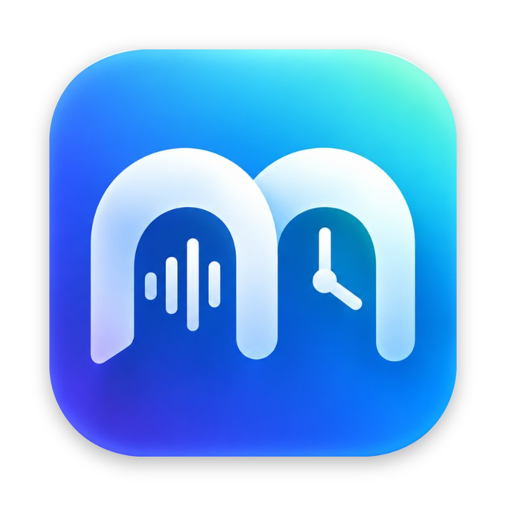
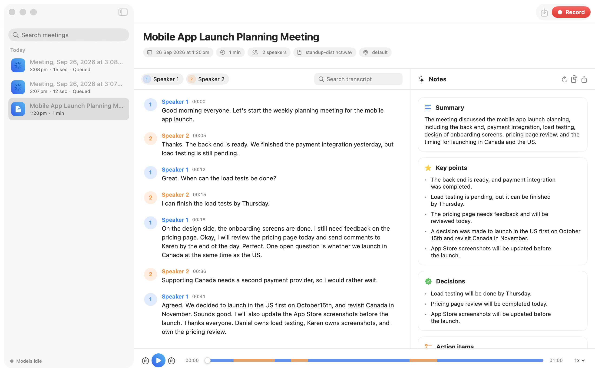
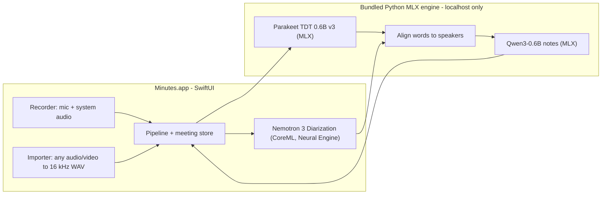

<p align="center">
  
</p>

<h1 align="center">Minutes</h1>

<p align="center">
  Local, private meeting notes for your Mac: record or import a meeting and get a speaker-labelled transcript
  and clear notes. Everything runs on your Mac with open models. Nothing is uploaded.
</p>

<p align="center">
  <a href="https://github.com/Baladhurgesh/minutes/releases/latest"><b>Download for macOS (Apple Silicon)</b></a>
</p>



## Features

- **Record** your microphone and the other side of the call (Zoom, Meet, Teams) via system audio, or **import** any audio or video file (drag and drop works).
- **Who said what**: speaker diarization with NVIDIA Nemotron 3 Diarization (up to 8 speakers). Rename speakers and regenerate the notes with their names.
- **Accurate transcripts** with word timestamps from NVIDIA Parakeet TDT 0.6B v3. Click any word to play from there; search the transcript.
- **Meeting notes** written by Qwen3-0.6B: summary, key points, decisions, action items (with checkboxes) and open questions. Copy or export as Markdown.
- **Private by design**: audio, transcripts and notes stay in `~/Library/Application Support/Minutes`.

## Install

Requirements: a Mac with Apple Silicon (M1 or later), macOS 14 Sonoma or later, about 5 GB free disk space.

1. Download `Minutes-<version>-arm64.dmg` from [Releases](https://github.com/Baladhurgesh/minutes/releases/latest), open it, and drag **Minutes** into **Applications**.
2. The app is not notarized by Apple yet, so the first launch needs one extra step:
   Control-click **Minutes** in Applications, choose **Open**, then click **Open**.
   If macOS still blocks it, open **System Settings > Privacy & Security** and click **Open Anyway**.
   Or, in Terminal: `xattr -dr com.apple.quarantine /Applications/Minutes.app`
3. On the first screen click **Download** to fetch the models (about 4 GB, one time).
4. Click **Record**. macOS asks for **Microphone** access, and for **Screen & System Audio Recording** access if you want call audio. No video is ever captured.

Tip: wear headphones on calls so your microphone does not pick up the other side twice.

## How it works



- The app runs speaker diarization with [FluidAudio](https://github.com/FluidInference/FluidAudio)'s CoreML build of Nemotron 3 while the engine transcribes on the GPU with [parakeet-mlx](https://github.com/senstella/parakeet-mlx), in parallel.
- Words are assigned to the speaker whose segment overlaps them most, then merged into turns.
- Qwen3-0.6B ([mlx-lm](https://github.com/ml-explore/mlx-lm)) writes the notes, map-reducing long meetings in chunks.
- The engine is a small FastAPI server bound to `127.0.0.1` with a per-launch token; the DMG ships it with a standalone Python.

## Models

| Task | Model | License |
|---|---|---|
| Speech recognition | [nvidia/parakeet-tdt-0.6b-v3](https://huggingface.co/nvidia/parakeet-tdt-0.6b-v3) (MLX: [mlx-community](https://huggingface.co/mlx-community/parakeet-tdt-0.6b-v3)) | see model card |
| Speaker diarization | [nvidia/Nemotron-3-Diarization](https://huggingface.co/nvidia/Nemotron-3-Diarization) (CoreML: [FluidInference](https://huggingface.co/FluidInference/nemotron-3-diarization-coreml)) | see model card |
| Notes | [Qwen/Qwen3-0.6B](https://huggingface.co/Qwen/Qwen3-0.6B) | see model card |

Models are downloaded from Hugging Face on first use and are not redistributed in this repository or the DMG.

## Model profiles

Which models run, and how, is set by JSON profiles (Settings > Models). Drop your own into
`~/Library/Application Support/Minutes/profiles/`:

```json
{
  "name": "fast-q8",
  "llm": {
    "model": "Qwen/Qwen3-0.6B",
    "config": {"bits": 8, "group_size": 64, "keep_high": ["embed_tokens", "lm_head"], "kv_bits": 8},
    "kernels": {"add_rmsnorm": "kernels/add_rmsnorm.py"}
  },
  "asr": {"model": "mlx-community/parakeet-tdt-0.6b-v3", "dtype": "bfloat16", "chunk_duration": 120},
  "diarization": {"backend": "fluidaudio-nemotron3", "preset": "fast128", "threshold": 0.5}
}
```

`llm.config` uses the deployment-config keys of visai (a model and kernel optimization agent), so an optimized
configuration found by `visai optimize` can be pasted in unchanged. `llm.kernels` maps an op to a promoted Metal
kernel file (paths relative to the profile) and is applied with visai's module patcher when visai is installed in
the engine environment (`cd engine && uv pip install -e /path/to/visai`); otherwise kernels are skipped with a warning.

## Build from source

Requirements: Xcode 16+, [uv](https://docs.astral.sh/uv/), `brew install xcodegen`.

```bash
git clone https://github.com/Baladhurgesh/minutes && cd minutes
cd engine && uv sync && cd ..                 # Python MLX engine
cd app && xcodegen generate && open Minutes.xcodeproj
```

A Debug build runs the engine from `engine/.venv`. To build the distributable app and DMG:

```bash
scripts/bundle_engine.sh          # -> dist/Minutes-<version>-arm64.dmg
```

Set `SIGN_IDENTITY="Developer ID Application: ..."` to sign with your certificate instead of ad-hoc.

### Repository layout

```
app/          SwiftUI app and minutes-cli (XcodeGen spec: app/project.yml)
engine/       Python MLX engine (ASR, alignment, notes, HTTP server) + tests
profiles/     bundled model profiles
scripts/      bundle_engine.sh, make_icon.py, make_sample_meeting.py
branding/     app icon source
```

### Tests and headless runs

```bash
cd engine && uv run --group dev pytest                       # engine unit tests
python3 scripts/make_sample_meeting.py                        # synthesize samples/standup.wav
app/build/Build/Products/Debug/minutes-cli run samples/standup.wav --out /tmp/minutes
```

`minutes-cli` also has `import`, `diarize` and `record` subcommands for testing each stage.

## License

[MIT](LICENSE). The models have their own licenses; see their model cards.
